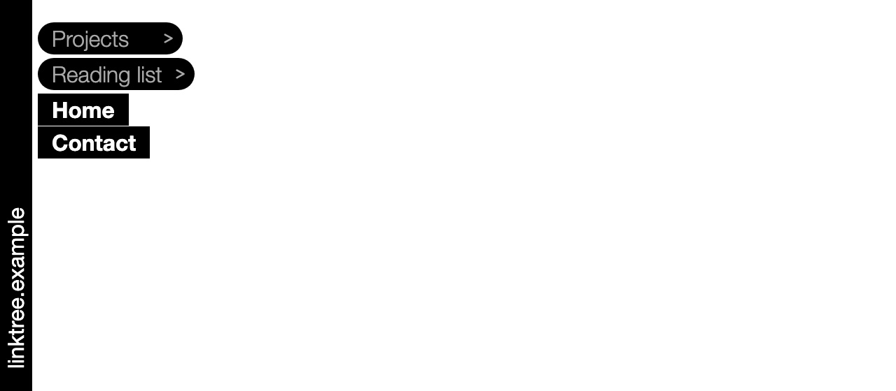

# linktree

Brutalist link pages with folders, eight designs and online editing. Static HTML, CSS and vanilla JS plus three small PHP scripts (`site.php`, `edit/save.php`, `edit/probe.php`). No build step, no framework.

| Closed | Opened (`/projects/archive/old-notes/`) |
|---|---|
|  |  |

## Deploy

Apache 2.4 with PHP; the document root is `<repo>/public`.

1. Copy `public/edit/.htaccess.example` to `public/edit/.htaccess`, set `AuthUserFile` to the absolute path of `public/edit/.htpasswd`.
2. `htpasswd -c public/edit/.htpasswd <user>`, then open `/edit/` once and sign in. `public/edit/` must be writable by PHP.
3. The first `/site.php` request copies `seeds/default.json` to `edit/site.json`; saves go there (previous: `site.bak.json`).

`site.json`, `site.bak.json`, `.htpasswd`, `.htaccess` in `public/edit/` are never committed.

## Data and paths

`edit/site.json`: `design`, `mode` (`light`/`dark`), `numbers`, `caps` (`regular`/`versalien`), `font`, `layout` (`list`/`split`), `height` (30 to 70 px), `intensity` (10 to 100 %), `items`. A link is `{ name, url, slug }`, a folder `{ name, items }`, folders nest. Designs: `vertical-heading` (default), `giant-type`, `giant-numerals`, `bracket-terminal`, `headline-tiny-links`, `raw-listing`, `tracked-rows`, `plain-inverted`.

- `/<folder>/<folder>/` shows the list with those folders open; `/<folder>/<link>/` also marks the link (split layout: loads it in the pane).
- With `?open` (or `?o`) a link path (`/<link>/?open` from anywhere, or `/<folder>/<link>/?open`) redirects to the link; a folder path shows the opened list. Real paths like `/edit/` are left alone.
- Folder slugs are the lower-case names with `-` (`tbx.li` is `tbx-li`).

## Keyboard

Works in the list and in edit mode, except while a field, menu or edit button has focus.

- Up/down move through the visible entries and wrap around; the first key after the mouse continues from the entry under the pointer.
- Right opens a folder or steps into an open one; left closes it or goes to the parent folder; Enter opens a link in a new tab or toggles a folder.
- The focused entry shows a 2 px line in the item colour, 4 px clear of the left rail and the item (`--focus-*` in `tokens.css`); an open folder shows a light `>` at one x left of the outermost items.
- The last input method wins: after a key the row icons and mouse-over highlight hide and the mark shows; moving or pressing the mouse reverses it. A page starts in mouse mode.
- The address bar follows the focus (a closed folder shows its parent), also on clicks; history is untouched.

## Editing

Open `/edit/` once; the browser then edits inline (`/?edit=0` switches off). Visitors see no controls. Hover a line:

- left: drag handle and pen (name, URL); right: `+` adds a link, the pill a folder after it (on an open folder's head: as its first item). They show after `--icon-delay` (0.2 s) at `--icon-opacity`, take no clicks until visible; touch devices always show them.
- grey dots change settings; the floppy icon shows while something is unsaved (Cmd/Ctrl+S saves). Light/dark is a per-browser view choice, never saved; the split divider drags per view.

Auto start (`EDIT.autoProbe` in `js/config.js`, off): add the `<Files "probe.php">` block from `.htaccess.example` to the live `.htaccess`, set it `true`; browsers holding credentials then start editing, others get a silent 401.

## Layout and commands

    public/        index.html (list), go.html (redirect), css/ (tokens, base, edit, designs/), js/ (config, logic, render, edit, go), edit/ seeds/ icons/ (PHP, dummy content)
    tests/ docs/ tools/   unit tests, specs and plans, dev router
    local/         git-ignored scratch data

    php -S 0.0.0.0:8080 -t public tools/dev-router.php   # local server
    npm test                                              # unit tests (node --test)

Pill form is `vertical-heading` (`PILL_DESIGNS`), all others are text form (`html[data-form]`). Change a value in one place: `tokens.css` first, then `config.js`. Bump `?v=N` on the CSS/JS links in `index.html` and `go.html` with every change (browsers cache for an hour).

## Status

Checked in the browser: all eight designs, folder animation, folder and `?open` paths, inline editing, arrow-key navigation, 50 unit tests. Content is dummy. `main` deploys to l.msmr.co via Plesk Git.

Not checked: the focus line in text-form designs and the split layout (its items clip it), the `>` in display mode (about 4 px beside the rail), edit mode in split/narrow/text-form, very long wrapped entries with the icon column, `.htaccess` rewrites on the live host.

Known limits: no input validation (owner's decision), drag and drop is mouse-only, font list and color variants empty.
