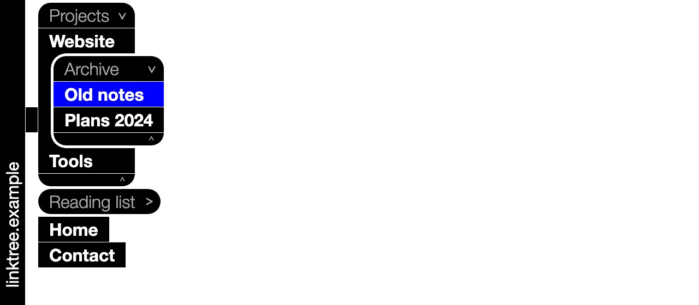

# linktree

Brutalist link pages with folders, eight designs and online editing. Static HTML, CSS and vanilla JS plus three small PHP scripts. No build step, no framework. Styling and details target `vertical-heading`; the other designs follow later.

| Closed | Opened (`/projects/archive/old-notes/`) | Keyboard |
|---|---|---|
|  |  |  |

## Deploy

Apache 2.4 with PHP, document root `<repo>/public`.

1. Copy `public/edit/.htaccess.example` to `public/edit/.htaccess`, set `AuthUserFile` to the absolute path of `public/edit/.htpasswd`.
2. `htpasswd -c public/edit/.htpasswd <user>`, open `/edit/` once and sign in. `public/edit/` must be writable by PHP.
3. The first `/-/site.php` request seeds `edit/site.json` from `-/seeds/default.json`; saves keep `site.bak.json`.

`site.json`, `site.bak.json`, `.htpasswd`, `.htaccess` in `public/edit/` are never committed. `main` deploys via Plesk Git.

## Data and paths

`edit/site.json`: `design`, `mode`, `numbers`, `caps`, `font`, `layout` (`list`/`split`), `height` (30 to 70 px), `intensity` (10 to 100 %), `items`. A link is `{ name, url, slug }`, a folder `{ name, items }`, folders nest. Folder slugs are the lower-case names with `-` (`tbx.li` is `tbx-li`); a link slug is a dash plus its name (`-docs`), so it never equals a folder slug, and gets a number only next to an identical sibling. Paths accept a link slug with or without the dash (old addresses keep working); opening edit mode adds the dash to older slugs, save once. `node tools/import-a.js > site.json` snapshots the sections and links of a.msmr.co (sections become top folders) for another instance.

- `/<folder>/<link>/` shows the list with the folders open and the link marked.
- `?open` (or `?o`) on a link path redirects to the link, from anywhere; on a folder path it shows the opened list.

## Keyboard

Up/down move and wrap; right opens a folder or jumps to its first subfolder; left closes it or goes to the parent; Enter opens a link in a new tab or toggles a folder. The mark is a band at links, a line at closed folders and a `>` at open ones; the address bar follows the focus. The last input wins: keys hide the row icons and hover highlight, the mouse brings them back. On mouse devices the page loads with the first entry (or the one the address names) marked.

## Editing

Open `/edit/` once; the browser then edits inline (`/?edit=0` switches off). Hover a line for the drag handle, pen and `+` icons; on touch, tap beside an entry. Drag the handle (mouse, finger or pen) to move an entry before, after or into another, to the end of a folder, behind a folder, or (below the list) to the end of the top level; Alt+arrow moves the focused entry (up/down among siblings, right into the folder above, left out of its folder). Grey dots change settings, the floppy icon saves (Cmd/Ctrl+S). In a home-screen app (no address bar) a small `edit` link shows for 8 s after load (`EDIT.link` in `config.js`): top left when editing is off, and in any browser under the settings dots when editing is on but the login cookie is missing (found by `probe.php`). Optional auto start: `EDIT.autoProbe`.

## Layout and commands

    public/      index.html, go.html, edit/ (login, save, probe), -/ (css, js, seeds, site.php, manifest, icons)
    tests/ docs/ tools/    unit tests, specs and plans, dev router

    php -S 0.0.0.0:8080 -t public tools/dev-router.php
    npm test

Everything except `edit/` lives in `/-/`, so no folder name from the list can clash with a path. Values: `tokens.css` first, then `config.js`. Bump `?v=N` on the CSS/JS links in `index.html` and `go.html` with every change. Pills scale with the window (`SCALE`), the pane needs 900 x 500 px (`SPLIT.query`).

## Status

Checked in the browser: `vertical-heading`, folders and animation, `?open` paths, inline editing, keyboard navigation; 51 unit tests. Not checked: other designs, edit mode in split/narrow, very long wrapped entries, `.htaccess` rewrites on the live host. No input validation (owner's decision).
